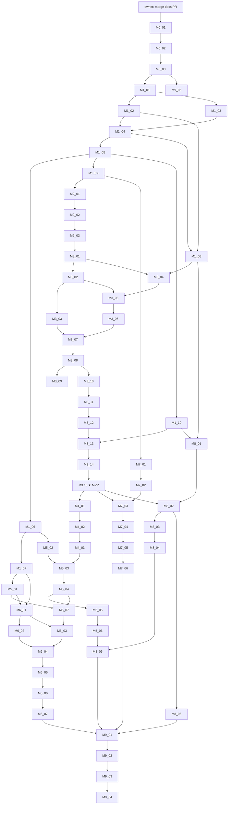

# Daytrack native iOS: build plan

This folder is the build plan for AI coding agents. Give an agent **one task file** from `tasks/`, plus `AGENT_BRIEF.md`. Do not give it anything else.

- `README.md` (this file) explains the end goal, the architecture, the workflow, the conventions, the milestones and the dependency graph.
- `AGENT_BRIEF.md` is the standing brief. Every task agent reads it first.
- `tasks/<id>-<slug>.md` holds one task per file: goal, why, dependencies, inputs, allowed files, out of scope, acceptance commands and named tests, and size.
- `handoff/` is a durable copy of the design bundle: HANDOFF.md, the copy deck, the design spec, the prototype and 28 screens. It was copied out of a scratch folder that can be cleared. Task M0.01 moves it to `docs/handoff/`. Every task file refers to it at that path.

**Plan shape.** 65 tasks in 10 milestones. 31 tasks lead to the MVP, at the end of M3. Domain rules come first, as pure, tested Swift (M1 and M2). The MVP after that includes reminders and Erase, so it supports the full daily habit loop.

---

## 1. End goal

A native iOS app, written in SwiftUI, that implements `docs/handoff/HANDOFF.md` as amended by `docs/decisions.md`. Where they conflict, decisions.md wins. The app must not reproduce any defect listed in `docs/design-review.md`.

When it is done, the app has:

- Four tabs: Today, History, Report and Settings. Trackers lives under Settings (Q7a).
- A Today board of at most 8 trackers. Each row is a drag-to-set slider. Tapping the value opens a choice pad with the stops, Skip and Leave blank, so no single tap erases anything (Q4).
- Days that close at the lock hour on the following day. The default lock hour is 23, and lock hour 0 means there is no grace day. `closedThrough` never moves backward (Q1).
- A visible difference between set, skipped and blank values everywhere: stats, copy and reports. Nothing is imputed.
- Wording revisions with absolute boundaries. No statistic crosses a boundary (rule 7, Q6).
- History, tracker detail, day detail, Week, Month and Compare, all of it era-windowed and with honest floors (Q5).
- A Report builder that produces paginated Letter PDF sheets, with a provenance sheet (Q3, Q7b).
- "Save a full copy" (JSON), CSV export, restore with a diff, a "move to a new phone" explainer, and Erase everything (Q2, Q3, Q8).
- A local daily reminder (`UNCalendarNotificationTrigger`, 14 days ahead), a missed-reminder strip and a lapse strip (Q10).
- A WidgetKit widget that shows counts only, plus home-screen quick actions.
- Native Liquid Glass on system controls (tab bar, nav bars, toolbars, `.buttonStyle(.glass)`, sheets); content is plain amber-on-warm-dark over a warm ambient background. It stays legible at AX5 text sizes; the system handles Reduce Transparency and Increase Contrast for glass.
- No network code, no server, no analytics and no third-party code (rule 1). The record is excluded from device backup (Q8).

---

## 2. Architecture

The layout is hexagonal and screaming. Folders are named after what the app does. The domain core imports Foundation only. Ports are protocols in the core, and adapters live at the edge.

```
AGENTS.md                  points to docs/plan/AGENT_BRIEF.md (created in M0.01)
CLAUDE.md                  "Read AGENTS.md before any task."
project.yml                XcodeGen spec: Daytrack app, DaytrackWidget (added in M8.04),
                           DaytrackAppTests, DaytrackUITests. Daytrack.xcodeproj is gitignored.
Local.xcconfig.example     DEVELOPMENT_TEAM, BUNDLE_PREFIX. The real Local.xcconfig is gitignored.
scripts/
  mac                      Linux: push, then run verify.sh on Thunderbolt through rex, capture, exit code
  verify.sh                Mac: core | app | lint | lint-selftest | all | shots | device
  scope.sh                 Linux: fail if the diff touches a file outside the task's ```scope globs
  done.sh                  Linux: the Definition of Done in one command (see §4)
docs/
  decisions.md  design-review.md  handoff/  plan/
DaytrackKit/               Swift package (swift-tools-version 6.2; platforms iOS 26, macOS 15)
  Sources/DaytrackCore/    Foundation only (enforced by lint)
    Calendar/   DayKey, DateRange, LocalCalendar
    Days/       DayClosing (lock hour, closedThrough), DayValue, DayEntry, Writes, DayCounts
    Trackers/   Tracker, TrackerType, ValueScale, ActiveSpan, StarterCatalog, Roster (cap 8)
    Wording/    ScaleRevision, Eras, WordingEditRule
    Stats/      TrackerSummary, Floors, HistoryRanges, Pairs, WeekGrid, Weekday
    Copy/       every user-facing string derived from data (one source; see design-review High 1)
    CopyFile/   CopyFileCodec (JSON v1), CSVExport
    Reminders/  ReminderPlan
    Board/      BoardStrip (missed / lapse)
    Widget/     WidgetFace (counts only)
    Report/     ReportDraft, Provenance, ReportPlan (pagination)
    Restore/    RestorePlan
    Record.swift (M1.05)  DeviceState.swift (M2.01)
    Ports/      RecordStore, DeviceStateStore, Clock, ReminderScheduling, WidgetPublishing
    UseCases/   Recorder, SettingsService, TrackerManager, Eraser, Restorer
  Sources/DaytrackStorage/ FileRecordStore, FileDeviceStateStore, InMemory stores
  Tests/DaytrackCoreTests/<Folder>/   Tests/DaytrackStorageTests/   (Swift Testing)
App/                       iOS target "Daytrack"
  Composition/   AppEnvironment (the only place adapters are wired), LaunchOverrides (#if DEBUG),
                 Fixtures (DEBUG seed records), RootView (onboarding | tabs | unreadable)
  DesignSystem/  AmbientBackground, Tokens, Typography, catalog (native glass controls only)
  Today/ Onboarding/ History/ Report/ Settings/ Trackers/ Data/ Reminders/ QuickActions/
                 Each feature has XxxContainer (owns the @Observable model and calls use cases)
                 and XxxView (presentational: plain values in, closures out, no stores or ports).
Widget/                    WidgetKit extension. Reads only widget-snapshot.json from the App Group.
AppTests/                  DaytrackAppTests: hosted Swift Testing for view models and adapters
UITests/                   DaytrackUITests: XCUITest flows, launched with DEBUG overrides
```

### Decisions and why

| Decision | Choice | Why |
|---|---|---|
| Xcode project from the CLI | **XcodeGen** from a checked-in `project.yml`. The generated `.xcodeproj` is gitignored. | Agents work on Linux and cannot drive the Xcode GUI. Hand-editing a UUID-keyed `project.pbxproj` (targets, widget embedding, entitlements) is fragile and causes merge conflicts. A 60-line YAML file is easy to review. XcodeGen is a build-time tool on the Mac only, not a runtime dependency. The owner installs it once (gate G1). Fallback if XcodeGen does not support Xcode 27.2: the owner creates the project once in Xcode with "Use folders" (synchronized groups), commits it, and adding targets becomes an owner step. |
| Domain location | Local Swift package `DaytrackKit` | `swift test` runs on the macOS host in seconds with no simulator. Package target boundaries enforce the dependency direction. |
| Persistence | One versioned JSON document, `record.json`, in `Application Support/Daytrack/`. Written atomically, file protection `completeUntilFirstUserAuthentication`, directory `isExcludedFromBackup`. `device.json` holds DeviceState (lastFullCopyAt, reportDraft, remindersScheduledThrough) and is never exported. | The data is tiny and uses the export schema, so it needs no migration framework. The file protection class lets a background notification action write after first unlock. `shortcut: whole-file rewrite per save, move to SQLite past ~5 MB`. |
| Unreadable store | Move it aside to `record-unreadable-<timestamp>.json` and never overwrite it. The app routes to a read-only screen that says the file was kept. | Without this, a decode bug would silently lose the only copy. |
| Widget data | The app writes `widget-snapshot.json` (counts and close line only) to the App Group container. The widget never reads the record. | Privacy rule (HANDOFF §3 and §8): a home screen is read by others. |
| Fonts | System SF with Dynamic Type, plus monospaced digits for numerals **[O6]**. | No assets and no licence files before the owner confirms. Bundled fonts are optional (M9.04). |
| Charts and PDF | Swift Charts. `ImageRenderer` into a CoreGraphics PDF context. | System frameworks, no dependency. |
| Third-party code | None. | Owner preference. |

**Rules that lint enforces** (`scripts/verify.sh lint`; every rule has a self-test in `lint-selftest`):
1. `DaytrackKit/Sources/**` contains no `import` other than `Foundation` or `DaytrackCore`.
2. No `URLSession`, `URLRequest`, `NWConnection`, `import Network`, `WKWebView` or `import WebKit` anywhere under `App/`, `Widget/` or `DaytrackKit/` (rule 1).
3. No drifted lock strings in Swift string literals: `23:59`, `until midnight`, `LOCKS 23`, `Before the day locks` (design-review High 1, decisions Q1 amendment 2).
4. No banned copy in Swift string literals: `logged`, `Nothing to log`, `streak`, `great job`. M9.02 widens this rule, and `scripts/lint-allow.txt` lists the allowed exceptions.
5. (Added in M9.02.) Motion inventory: `withAnimation` and `.animation(` only in allow-listed files.

---

## 3. Agent dev workflow

**Agents edit on Linux, and the Mac builds and tests through rex. Git is the only way code moves between them.**

Why: Linux has no Swift or Xcode. Editing on the Mac through rex would mean blind shell heredocs with no file tools and no reviewable history. With git, every verified state is a commit, and one command returns one exit code.

1. Agents edit only the Linux checkout `/home/znt/repos/daytrack`, on the branch `<type>/<task-id>-<slug>`, for example `feat/m1.02-day-closing`. Never on main.
2. The agent commits, then runs `scripts/mac <target> [arg]` on Linux. The script:
   1. refuses to run on `main` or with uncommitted changes (exit 2);
   2. runs `git push -q -u origin HEAD`;
   3. runs this on Thunderbolt:
      ```
      rex -S Thunderbolt run -s daytrack --label "verify-$BR" --keep-open --focus=false \
          --json --shell=none --wait -- zsh -lc "cd ~/repos/daytrack \
          && { test -z \"\$(git status --porcelain)\" || exit 3; } \
          && git fetch -q origin && git switch -q --detach origin/$BR \
          && SIM='${SIM:-iPhone 18 Pro}' DEVICE='${DEVICE:-}' scripts/verify.sh $TARGET $ARG"
      ```
      `--shell=none` with `zsh -lc` makes `~` expand on the Mac, not on Linux. Only `SIM` and `DEVICE` are forwarded. The `--wait` exit status is the remote exit status.
   4. reads the block id from the JSON creation line. Confirm the field name once in M0.02 with `rex -S Thunderbolt run --json -- true`.
   5. runs `rex -S Thunderbolt capture -s daytrack -b <id> --trim --unwrap > .verify/last.log` (gitignored), then prints the last 60 lines;
   6. exits with the remote exit code.
3. The Mac checkout `~/repos/daytrack` only builds. Nobody edits it. If it is dirty, the wrapper refuses (exit 3) and resets nothing. `git switch --detach` never discards commits. All build output goes to gitignored `build/`.
4. **Exactly one task runs at a time**, because there is one Mac runner and one simulator. No milestones run in parallel.

### `scripts/verify.sh` targets (run on the Mac)

| Target | Runs | Exit |
|---|---|---|
| `core [Filter]` | `swift test --package-path DaytrackKit [--filter Filter]` | the swift exit code |
| `app [OnlyTesting]` | `xcodegen generate --quiet`, then `xcodebuild test -project Daytrack.xcodeproj -scheme Daytrack -destination "platform=iOS Simulator,name=$SIM" -derivedDataPath build/DD [-only-testing:OnlyTesting]`. The full log goes to `build/xcodebuild.log`; stdout shows only lines matching `Test (Case\|case)\|✔\|✘\|error:\|\*\* TEST`. | the xcodebuild exit code; 4 if xcodegen is missing; 5 if `$SIM` is not an available simulator |
| `lint` | the rules above (4 until M9.02 adds rule 5) | 0 or 1 |
| `lint-selftest` | puts one violating fixture per rule in a temp dir and asserts that lint fails on each | 0 or 1 |
| `all` | `lint-selftest`, then `lint`, then `core`, then `app` (stops at the first failure) | first failure |
| `shots <screen>` | builds and boots `$SIM`, then launches `-uiTestScreen <screen>` four times: default, `-uiTestLegibility reduceTransparency`, `-uiTestLegibility increaseContrast`, and `-UIPreferredContentSizeCategoryName UICTContentSizeCategoryAccessibilityXXXL`. Writes `build/shots/<screen>-<variant>.png` on the Mac. | 0 or 1 |
| `device` | `xcodebuild -scheme Daytrack -configuration Release -destination 'generic/platform=iOS' -allowProvisioningUpdates build`, then `xcrun devicectl device install app --device "$DEVICE" <app>` | 0 or 1 |
| `release-check` | added in M9.03: Release build, then a `strings` check that no DEBUG launch override is in the binary | 0 or 1 |
| anything else | prints usage | 64 |

### Command reference (always run from Linux)

| Purpose | Command |
|---|---|
| Domain tests for one suite | `scripts/mac core DayClosingTests` |
| One UI test class | `scripts/mac app DaytrackUITests/OnboardingUITests` |
| One app unit test suite | `scripts/mac app DaytrackAppTests/RowStateTests` |
| Another simulator | `SIM='iPhone 17e' scripts/mac app DaytrackUITests/TodayBoardUITests` |
| Everything | `scripts/mac all` |
| **Definition of Done** | `scripts/done.sh <TASK-ID>` |

---

## 4. Conventions and Definition of Done

**Container rule.** A task that adds or changes UI on an existing screen also lists that screen's container (`*Container.swift`) in its scope. Views are presentational and have no `AppState`, so the container is the only place that wires new UI to the use cases. A task that adds a new screen lists the parent that presents it (a container or `RootView`).

- **Branches:** `<type>/<task-id-lowercase>-<slug>`, branched from `main`. If a dependency is not merged yet, stack the branch on the dependency's branch and say so in the PR (chained PR).
- **Commits:** conventional commits (`feat(today): …`, `test(core): …`, `build: …`). No AI attribution, no `Co-Authored-By` line, no "Generated with" line.
- **PR:** the title is `<type>(<scope>): <TASK-ID> <title>`. The body contains the goal, the tail of `.verify/last.log`, any **[O#]** defaults used, and a **Follow-ups** section. Work found outside the task's scope goes in Follow-ups and is never done in the task. The owner merges. Agents never merge and never push to main.
- **Size:** at most **400 changed lines**. Generated files, `docs/handoff/**` and binary files do not count. S is under 150 lines, M is 150 to 300, L is 300 to 400. If a task will not fit, stop and propose a split in the PR instead of overrunning.
- **Tests:** behaviour-first, and named for the behaviour.
  - Core and app unit tests use Swift Testing: `@Suite struct XTests { @Test func behaviourName() }`.
  - UI tests use XCTest: `final class XUITests: XCTestCase { func testBehaviour() }`.
  - UI tests never rely on drag gestures or system sheets. Gesture logic is tested in models (`RowState`). Sheets are bypassed with DEBUG launch arguments (§6).
- **Views:** container-presentational. A presentational view never touches a store, port or use case.
- **Smallest change that works:** no "for later" abstractions, no options nobody asked for, and no dependencies.

**Definition of Done: `scripts/done.sh <TASK-ID>` exits 0.** The script runs, in order:
1. `scripts/scope.sh <TASK-ID>`. Every path in `git diff --name-only origin/main...HEAD` must match a glob in the task file's ```` ```scope ```` block.
2. A size check. `git diff --numstat origin/main...HEAD`, excluding `docs/handoff/**` and binary files, must total at most 400 lines.
3. A commit check. Every subject in `git log origin/main..HEAD` must match `^(feat|fix|test|refactor|docs|build|chore|perf)(\([a-z0-9.-]+\))?: .+`, and no message may match `(?i)co-authored-by|generated with|ai-generated`.
4. `scripts/mac all`.
5. The named-test check. Every name in the task file's ```` ```tests ```` block must appear on a line of `.verify/last.log` that also contains `passed`.
6. Any extra command listed under **Also run** in the task. These are listed explicitly and done.sh does not run them.

Tasks M0.01 and M0.02 come before done.sh exists, so each lists its own literal acceptance commands.

---

## 5. Milestones

| Milestone | Outcome | Tasks | Count |
|---|---|---|---|
| M0 Foundations | Bundle in the repo, rulebook, Mac runner, an empty app that builds green | M0.01–M0.03 | 3 |
| M1 Domain core | Every honesty rule as pure tested Swift: days and closing, entries with set/skip/blank, revisions and eras, stats windows and floors, derived copy, the copy-file codec, the reminder plan | M1.01–M1.10 | 10 |
| M2 Storage and use cases | A durable store and the application services | M2.01–M2.03 | 3 |
| **M3 MVP, on the owner's phone** | **Onboarding, the board with the pad, amend yesterday, note, lock hour, save a full copy, erase, the daily reminder, basic trackers, installed on the iPhone** | M3.01–M3.17 (M3.16–17: G4 polish) | 17 |
| M4 Trackers complete | Entry modes, create and edit with revisions, reorder, bring back, delete | M4.01–M4.03 | 3 |
| M5 Read side | Pairs and week domain, History, tracker detail, day detail, Week and Month, Compare | M5.01–M5.07 | 7 |
| M6 Report | Draft and provenance, pagination, builder, sheets, PDF | M6.01–M6.07 | 7 |
| M7 Data lifecycle | Restore plan, picker and refusals, diff and apply, CSV, move explainer, storage screen | M7.01–M7.06 | 6 |
| M8 Platform | Board strips, widget, quick actions, time-zone note | M8.01–M8.06 | 6 |
| M9 Hardening | Accessibility audit, voice and motion lint, privacy and release checks, optional appearance extras, app icon | M9.01–M9.05 | 5 |

**The MVP is M3.** At the end of M3.15 the owner installs a signed build on their own iPhone and uses it every day. History, Report, Restore and the widget come after that. The data is safe in the meantime: M1.09 proves that a saved copy decodes back to the same Record, so restore (M7) will be able to read files saved during the MVP.

### Full task list

| ID | Title | Size | Depends on |
|---|---|---|---|
| M0.01 | Import the design bundle and write AGENTS.md | S | owner gate G0 |
| M0.02 | Mac runner, lint, scope and done scripts | M | M0.01 |
| M0.03 | Package and XcodeGen skeleton | M | M0.02 |
| M1.01 | Calendar primitives | S | M0.03 |
| M1.02 | Day closing and closedThrough | M | M1.01 |
| M1.03 | Trackers, value scale, roster | M | M1.01 |
| M1.04 | Day entries, writes, day counts | M | M1.02, M1.03 |
| M1.05 | Wording revisions and eras | M | M1.04 |
| M1.06 | Tracker summaries (era-windowed) | M | M1.05 |
| M1.07 | Floors, shortfalls, history ranges | S | M1.06 |
| M1.08 | Derived copy | M | M1.02, M1.04 |
| M1.09 | Copy-file codec and CSV | M | M1.05 |
| M1.10 | Reminder plan | S | M1.05 |
| M2.01 | Record, ports and file store | M | M1.09 |
| M2.02 | Recorder and settings use cases | M | M2.01 |
| M2.03 | TrackerManager use case | M | M2.02 |
| M3.01 | App shell, composition root, launch overrides, fixtures | M | M2.03, M0.03 |
| M3.02 | Design system tokens and native glass gate | M | M3.01 |
| M3.03 | Onboarding | M | M3.02 |
| M3.04 | Row state model (pure gesture and label logic) | S | M3.01, M1.08 |
| M3.05 | Slider row view | M | M3.04, M3.02 |
| M3.06 | Choice pad | M | M3.05 |
| M3.05b | Compact slider row so eight fit on one screen | S | M3.05, M3.06 |
| M3.07 | Today board container | L | M3.06, M3.03 |
| M3.08 | Day turn and Amend yesterday | M | M3.07 |
| M3.09 | Note | S | M3.08 |
| M3.10 | Settings and lock hour | S | M3.08 |
| M3.11 | Save a full copy | M | M3.10 |
| M3.12 | Erase everything | L | M3.11 |
| M3.13 | Notification scheduler adapter (with platform spike) | M | M3.12, M1.10 |
| M3.14 | Reminder setting, permission, day-one screen | M | M3.13 |
| M3.15 | Basic trackers and device install (★ MVP) | M | M3.14 |
| M4.01 | Stepper and large entry modes | M | M3.15 |
| M4.02 | Create and edit a tracker, with wording revisions | L | M4.01 |
| M4.03 | Reorder, bring back, delete | M | M4.02 |
| M5.01 | Pairs (domain) | S | M1.07 |
| M5.02 | Week grid and weekday panel (domain) | S | M1.06 |
| M5.03 | History tab | L | M4.03, M5.02 |
| M5.04 | Tracker detail | M | M5.03 |
| M5.05 | Day detail and back paths | S | M5.04 |
| M5.06 | Week and Month grids | M | M5.05 |
| M5.07 | Compare | M | M5.04, M5.01 |
| M6.01 | ReportDraft, provenance, ReportDrafts use case (domain) | L | M1.07, M5.01 |
| M6.02 | ReportPlan pagination (domain) | M | M6.01 |
| M6.03 | Report tab, builder, add-to-report entries | L | M6.01, M5.07 |
| M6.04 | Summary and provenance sheets | M | M6.03, M6.02 |
| M6.05 | Tracker chart and pair sheets | M | M6.04 |
| M6.06 | Day table and notes sheets | S | M6.05 |
| M6.07 | PDF render and share | M | M6.06 |
| M7.01 | Restore plan: days and refusals (domain) | M | M1.09 |
| M7.02 | Restore plan: tracker conflicts and cap (domain) | M | M7.01 |
| M7.03 | Restore picker and refusal screens | M | M7.02, M3.15 |
| M7.04 | Restore diff, apply, onboarding entry | L | M7.03 |
| M7.05 | Other formats (CSV) and the move explainer | S | M7.04 |
| M7.06 | Storage screen | S | M7.05 |
| M8.01 | Board strip rule (domain) | S | M1.10, M1.08 |
| M8.02 | Missed-reminder and lapse strip | S | M8.01, M3.15 |
| M8.03 | Widget face and snapshot writer | M | M8.02 |
| M8.04 | Widget extension and App Group | M | M8.03 |
| M8.05 | Home-screen quick actions | S | M8.04, M5.06 |
| M8.06 | Time-zone crossing note | S | M8.02 |
| M9.01 | Accessibility audit | M | M8.05, M8.06, M7.06, M6.07 |
| M9.02 | Copy and voice lint | S | M9.01 |
| M9.03 | Privacy manifest and release check | S | M9.02 |
| M9.04 | Appearance extras (owner-gated, optional) | M | M9.03, owner answer O6 |
| M9.05 | App icon | S | M0.03 (may be pulled forward) |

### Dependency graph

The run order is the table order. Runs are serial because there is one Mac.



The pure domain tasks off the MVP path (M5.01, M5.02, M6.01, M6.02, M7.01, M7.02, M8.01) need only M1. M9.05 (app icon) needs only M0.03; pulling it before M3.15 gives the MVP its icon. They can be pulled forward when the owner wants core-only work, for example while waiting on an owner gate.

---

## 6. Test infrastructure (built in M3.01)

**DEBUG-only launch arguments.** They live in `App/Composition/LaunchOverrides.swift`, wrapped in `#if DEBUG`. M9.03 checks that the Release binary does not contain them.

| Argument | Effect |
|---|---|
| `-uiTestNow 2027-03-10T10:00:00` | The clock starts at this local instant and then runs at real speed (OffsetClock) |
| `-uiTestTZ America/New_York` | Time zone for the calendar and clock |
| `-uiTestStore memory` or `-uiTestStore <name>` | `memory`: in-memory stores, nothing touches disk. `<name>`: real file stores in `tmp/<name>/`. A test passes the same UUID on each launch, so relaunch tests read real files |
| `-uiTestSeed <fixture>` | Seed the record from a deterministic fixture |
| `-uiTestLockHour <0-23>` | Override the seeded lock hour (M3.01) |
| `-uiTestScreen <name>` | Open a DEBUG screen directly: `catalog`, `today`, `settings`, … |
| `-uiTestLegibility reduceTransparency\|increaseContrast` | Unused since the native-glass decision; the system resolves glass legibility |
| `-uiTestExportTo <dir>` | Save a copy by writing to this directory instead of presenting `.fileExporter` (M3.11) |
| `-uiTestRestoreFile <fixture>` | Restore from a bundled fixture instead of `.fileImporter` (M7.03) |
| `-uiTestNotifications fake\|fakeDeny` | A fake notification center that grants or denies (M3.13; used by M3.14) |
| `-uiTestShortcut <type>` | Dispatch a quick action at launch (M8.05) |

**Seed fixtures** (`App/Composition/Fixtures/`; they are deterministic and never call the real clock):
`threeTrackersEmpty`, `eightTrackers`, `fortyDays`, `ninetyDaysWithRevision`, `yesterdayWhollyBlank` (with reminderAt 21:30 and `remindersScheduledThrough` set), `allArchived`; M8.06 adds `todayWrittenInLondon`.

**Export temp files.** Every export (full copy, CSV, PDF) writes into `tmp/Exports/`, deletes its file when the sheet closes, and `AppEnvironment` purges the folder on launch; Erase purges it too (M3.11, M3.12).

---

## 7. Owner gates (only the owner can do these)

| Gate | When | Action |
|---|---|---|
| G0 | before M0.01 | Merge the docs branch (`chore/design-docs`, which includes `docs/plan/`) into main |
| G1 | M0.02 | On Thunderbolt: `brew install xcodegen`. Confirm the iPhone 18 Pro and iPhone 17e simulators exist |
| G2 | M0.03 | Say which iOS version your iPhone runs (Settings › General › About). Confirms **[O7]** |
| G3 | M3.02 | Approve the catalog screenshots (native glass controls over the warm background) in `~/repos/daytrack/build/shots/` on the Mac |
| G4 | M3.15 | Fill in `Local.xcconfig` (DEVELOPMENT_TEAM, BUNDLE_PREFIX), connect the phone, enable Developer Mode, and say whether the account is free or paid **[O8]** |
| G5 | every PR | Review and merge |

## 8. Proposed defaults (agents implement them and flag them in the PR; the owner can overturn any)

- **O1 Strip rule.** The missed strip shows when a reminder was scheduled for yesterday and yesterday is wholly blank. The lapse strip shows when the last day with anything written is 3 or more days before today. If both apply, missed wins. Amend stays offered while yesterday is open. The docs leave precedence undefined (design-review Medium 14).
- **O2 Restore** accepts JSON only. CSV is export-only because it is lossy, and a CSV file is refused with a reason.
- **O3 Pair split.** "Above" means strictly greater than A's mean. Ties count as "not above".
- **O4 Weekday panel** shows n per bar and never names a winner, because no noise threshold is specified.
- **O5** Markdown and Apple Health export are cut from v1.
- **O6 Fonts.** System SF with Dynamic Type. Instrument Sans and Plex Mono, the accent picker and night shade are dropped unless the owner keeps them (M9.04).
- **O7** Deployment target iOS 26.0 (the first release with Liquid Glass APIs). Confirmed against the owner's phone at gate G2.
- **O8** A free Apple account's builds stop launching after 7 days. Data survives a reinstall with the same bundle id.
- **O9 Range ends.** History ranges end today. Report ranges end at `closedThrough`.
- **O10 Bundle id.** `$(BUNDLE_PREFIX).daytrack`, set from Local.xcconfig and never hard-coded.
- **O11 Day-one-written screen.** Shown once, never mid-drag: when the first day's board has no blanks left, or on the first launch after a day with anything written, whichever is first. The docs do not say when it appears (M3.14).
- **O12 Restore of absent days.** "A day this phone has" means a DayEntry exists. Absent days come in even at or before `closedThrough`; a day with an entry is never changed. Without this, a phone move could bring no history (M7.01).
- **O13 Time-zone note.** The wording, and its precedence below the missed and lapse strips. HANDOFF §9 requires the explanation but gives no copy (M8.06).

## 9. Deliberately not built

Covered by AGENT_BRIEF's native deltas, plus these, so no agent builds them by accident:
- PWA surfaces (install, service worker, offline and caching states and their progressbar, update strip, icon badge), all Android material, the iPhone/Android segmented control and its tablist accessibility, Q9 and Q10b.
- Automatic backup, endpoints, QR pairing and "Two devices" ownership (Q2, Q8); "Let the file win" and "Correct the wording" (Q3, Q6).
- Markdown and Apple Health export (O5); fonts, accent picker and night shade unless the owner keeps them (O6, M9.04).
- Hardware-keyboard Home/End on the slider. VoiceOver increment and decrement cover the adjustable control (M3.05).
- Interactive and Lock Screen widgets, App Intents, Siri and Control Center.
